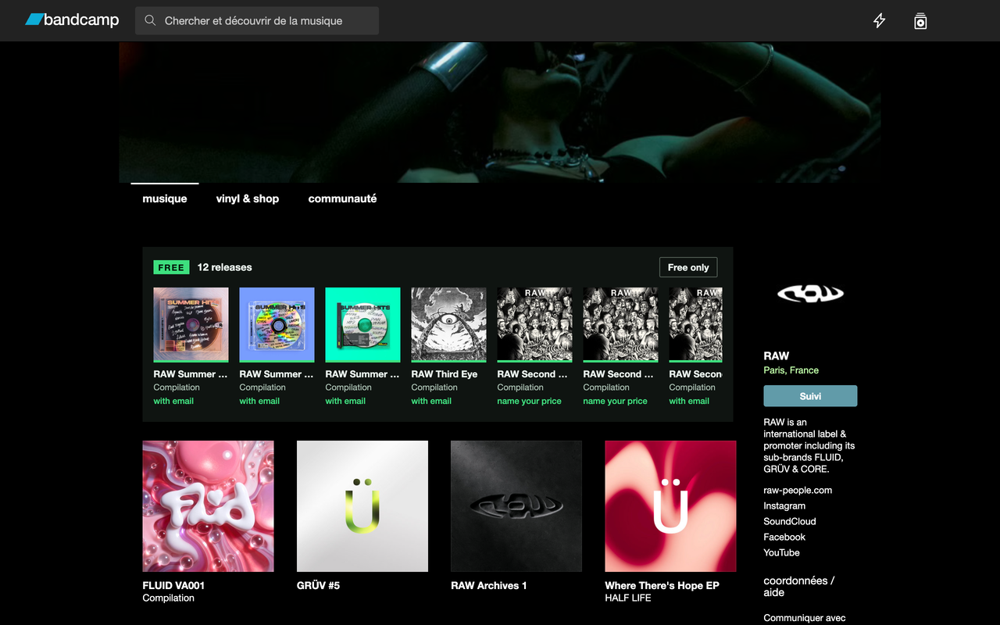
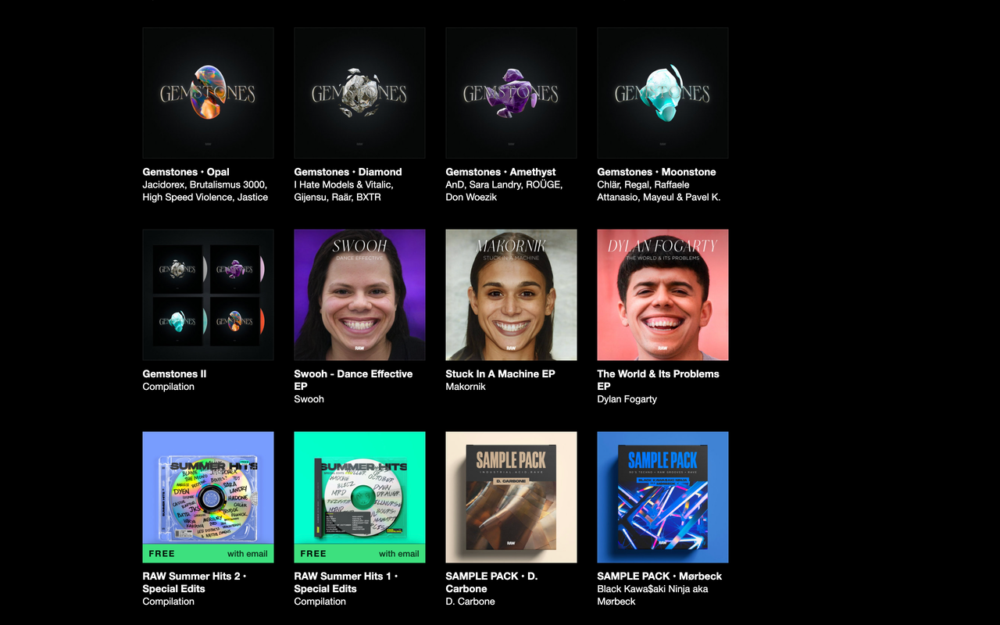
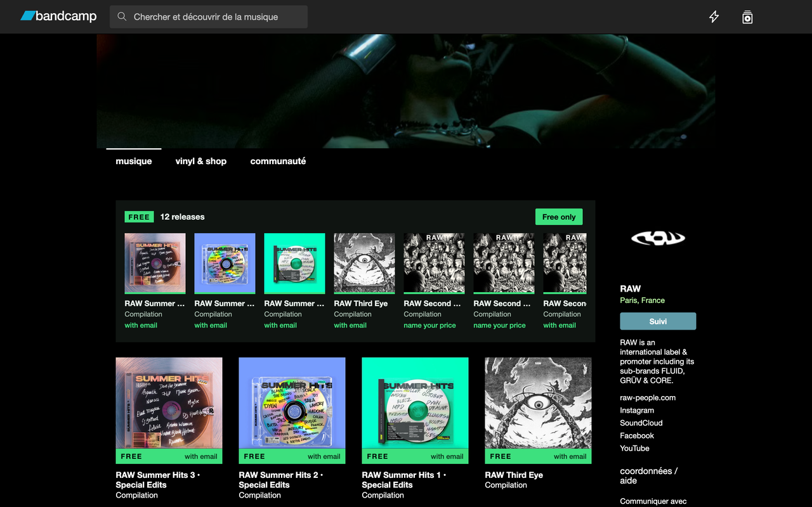

<p align="center"></p>

<h1 align="center">Free Download Finder for Bandcamp</h1>

<p align="center">Spot free downloads and name-your-price releases on Bandcamp label and artist pages, without opening each album.</p>



## What it does

Open a label or artist page on Bandcamp: the extension checks the releases in the background and shows you which ones you can download for free.

**A band on every free cover.** Free releases get a green band at the bottom of their cover, saying how they're free.

| Band | Meaning |
| --- | --- |
| **FREE** · name your price | The minimum price is 0: enter 0 at checkout |
| **FREE** · with email | Free download, Bandcamp asks for an email address |
| **FREE** · 2 of 5 tracks (dark band) | A paid release with some tracks free on their own |



**The free list.** A strip above the grid lists the free releases in page order, as they're found, with how much of the grid is checked. The toolbar icon shows the count for the tab.

**Free only.** One click hides the releases known to be paid, so only the free ones (and the ones not checked yet) remain.



**Big labels too.** Labels of up to 100 releases are checked in full. On bigger ones, the extension checks the covers you look at, and **Check the other N** in the strip does the rest, at a pace Bandcamp accepts.

## Install

Until it's on the Chrome Web Store, load it unpacked:

1. Open `chrome://extensions` and turn on **Developer mode**.
2. Click **Load unpacked** and pick this folder.
3. Open a label page, like `https://<label>.bandcamp.com/music`.

After an update, click the reload icon on the extension's card, then reload the Bandcamp tab.

## Good to know

- **Private.** No account, no analytics: the extension only talks to Bandcamp release pages (without your cookies) and keeps its answers on your computer for 24 hours. Bandcamp pages can tell it's installed, because the page-side code is loaded from the extension. Details in the [privacy policy](PRIVACY.md).
- **Light on Bandcamp.** On-screen covers first, a few requests at a time per label, a pause when Bandcamp asks for one (the strip then says "waiting for Bandcamp"), and no work at all on album, track or fan pages.
- **Limits.** Only `*.bandcamp.com` pages (labels on their own domain aren't covered), and only the release grid, not the discography sidebar or the recommendations.
- Not affiliated with Bandcamp.

## How it works

Every Bandcamp album and track page carries its sale data as JSON in a `data-tralbum` attribute. The service worker reads each release page up to that attribute (about a fifth of the page) and looks at `current.minimum_price`, `current.require_email` and `trackinfo[].has_free_download`. The content script draws the band and the list from its answers.

<details>
<summary>Project layout</summary>

```
manifest.json
js/
  bg.js                 service worker entry: routes the content script's messages
  content.js            content script entry: imports js/content/main.js
  shared/verdict.js     what a release page says about its price; release URLs
  worker/
    verdicts.js         cache, then a queue per host; one read per release
    queue.js            a few at a time, on-screen covers first
    sale-page.js        reads a page up to its sale data; timeouts, retries
    pace.js             per-host budget (burst, then spaced), pauses after a 429
    cache.js            24 h cache in chrome.storage.local
    toolbar.js          the count on the toolbar icon
  content/
    main.js             wires the scan to the band, the list and the count
    scan.js             checks tiles: on screen, on scroll, or all of them
    tiles.js            reads Bandcamp's grid: tiles, URLs, titles, covers
    band.js             the band on a free cover
    free-list.js        the strip above the grid
    messages.js         messages to the worker; stops when orphaned
css/
  tokens.css            shared colours and easing
  band.css              the band and the scan line
  free-list.css         the strip and "Free only"
icons/
  src/icon-*.svg        icon sources, one per size (16 and 32 drop the record)
  icon-*.png            what the manifest and the stores use
store/
  screenshots/          Chrome Web Store screenshots, 1280x800
  promo/                promo tiles (src/*.html -> npm run promo)
  listing.md            what to paste in each field of the store listing
```

Content scripts can't be ES modules, so `js/content.js` loads `js/content/main.js` with a dynamic `import()`. That's why `js/content/` and `js/shared/` are `web_accessible_resources`; a test checks that every imported module is listed.

</details>

## Development

```bash
npm install
npm test        # unit tests (node:test)
npm run lint    # Biome
npm run icons   # icons/src/*.svg -> icons/*.png, with headless Chrome
npm run promo   # store promo tiles, with headless Chrome and ffmpeg
npm run zip     # the package the store gets (the release workflow builds it)
```

Store screenshots are taken by hand, because Bandcamp blocks automated browsers. In Chrome, with the extension loaded: DevTools, device toolbar at 1280x800 (any DPR), then **Capture screenshot**. Cover anything personal (your Bandcamp avatar, top right), then turn the capture into the store's format (1280x800, 24-bit PNG without alpha; a test checks it):

```bash
sh scripts/store-shot.sh ~/Downloads/capture.png 2-bands-on-covers.png
```

## Publishing a version

A version tag publishes the extension. On `v1.2.0`, the [Release workflow](.github/workflows/release.yml) checks that the tag matches `manifest.json`, runs the tests and the lint, builds the zip with `npm run zip`, uploads it to the Chrome Web Store and submits it for review:

```bash
npm run release -- patch   # 1.1.0 -> 1.1.1; or minor, major, or an exact version like 1.2.0
```

```bash
git push --follow-tags
```

`npm run release` only runs on a clean `master`. It runs the tests and the lint, sets the version in `package.json`, `package-lock.json` and `manifest.json`, commits "Release 1.1.1" and tags `v1.1.1`. Pushing the tag starts the workflow (Actions tab); the review status is then in the [Developer Dashboard](https://chrome.google.com/webstore/devconsole). Because the extension reads `*.bandcamp.com`, a review often takes a few days.

To run it again, say after fixing the setup: **Actions**, **Release**, **Run workflow**, with the tag picked under **Use workflow from**. A version that's already submitted is left alone, so a second run is harmless. Tick **Dry run** (on `master` or a tag) to only build and check the credentials: it reads the store status and uploads nothing.

Good to know:

- While a version is in review, the next one waits: the workflow stops and says so. Wait for the review, or cancel it in the dashboard, then run the workflow again from the tag.
- The API publishes with the visibility already set. After changing the visibility in the dashboard, publish once by hand there, or the API refuses.
- The store listing (text, screenshots, privacy) is still edited in the dashboard; the API only sends packages.

### One-time setup

The workflow signs in to Google as a service account through Workload Identity Federation: GitHub gives the run a token that Google trades for a 15-minute one. There's no key or password to store, so GitHub needs no secret, only two variables. The publisher ID and the extension ID are in the workflow; they name the item but give no access to it.

1. **A Google Cloud project.** In the [Google Cloud console](https://console.cloud.google.com/), create a project (or reuse one) and note its ID, shown in the project picker.

2. **The service account and the link with GitHub.** Open Cloud Shell (the `>_` button at the top of the console), set your project ID on the first line, and paste:

   ```bash
   PROJECT_ID=your-project-id
   gcloud config set project "$PROJECT_ID"
   gcloud services enable chromewebstore.googleapis.com iam.googleapis.com iamcredentials.googleapis.com sts.googleapis.com

   gcloud iam service-accounts create cws-publisher --display-name="Chrome Web Store publisher"
   gcloud iam workload-identity-pools create github --location=global --display-name="GitHub Actions"
   gcloud iam workload-identity-pools providers create-oidc free-download-finder \
     --location=global --workload-identity-pool=github \
     --issuer-uri="https://token.actions.githubusercontent.com" \
     --attribute-mapping="google.subject=assertion.sub,attribute.repository_id=assertion.repository_id" \
     --attribute-condition="assertion.repository_id == '1040927428' && (assertion.ref.startsWith('refs/tags/v') || assertion.ref == 'refs/heads/master')"

   POOL=$(gcloud iam workload-identity-pools describe github --location=global --format="value(name)")
   gcloud iam service-accounts add-iam-policy-binding "cws-publisher@$PROJECT_ID.iam.gserviceaccount.com" \
     --role=roles/iam.workloadIdentityUser \
     --member="principalSet://iam.googleapis.com/$POOL/attribute.repository_id/1040927428"

   gcloud iam workload-identity-pools providers describe free-download-finder \
     --location=global --workload-identity-pool=github --format="value(name)"
   echo "cws-publisher@$PROJECT_ID.iam.gserviceaccount.com"
   ```

   `1040927428` is this repository's GitHub ID, which survives a rename. Only this repository, from a `v` tag or from `master`, can get a token. The last two lines print the provider's name (`projects/…/providers/free-download-finder`) and the service account's email.

3. **The Chrome Web Store.** In the [Developer Dashboard](https://chrome.google.com/webstore/devconsole), under **Account**, add the service account's email (a publisher takes one service account).

4. **GitHub.** In the repository's **Settings**, **Secrets and variables**, **Actions**, **Variables** tab, add `GCP_WORKLOAD_IDENTITY_PROVIDER` (the provider's name) and `GCP_SERVICE_ACCOUNT` (the email). Or, from this folder:

   ```bash
   gh variable set GCP_WORKLOAD_IDENTITY_PROVIDER --body "projects/…/providers/free-download-finder"
   ```

   ```bash
   gh variable set GCP_SERVICE_ACCOUNT --body "cws-publisher@your-project-id.iam.gserviceaccount.com"
   ```

5. **A dry run.** **Actions**, **Release**, **Run workflow** on `master`, with **Dry run** ticked. The log of the last step shows the published version and "the credentials work". A new service account can take a minute or two to be accepted.
